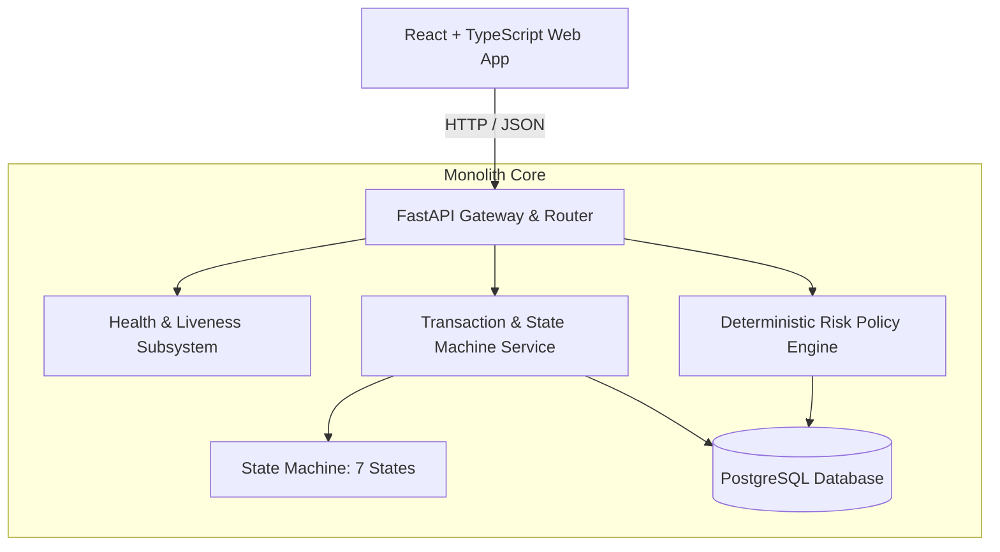

# AegisPay AI System Architecture

This document provides a high-level overview of the AegisPay AI architecture, system components, and interaction patterns.

For the detailed project governance and operational specifications, please refer to the authoritative document at [docs/project/architecture.md](project/architecture.md).

---

## 1. High-Level Architecture

AegisPay AI is built as a **Modular Monolith** designed for high throughput, auditable transaction evaluation, and multi-modal fraud investigation.

---

## 2. Key Subsystems

1. **API Layer (`backend/app/api`)**:
   - Thin asynchronous HTTP controllers.
   - Provides `/health/live` (process liveness) and `/health/ready` (database dependency readiness).
   - Versioned root router at `/api/v1`.

2. **Core Foundation (`backend/app/core`)**:
   - `config.py`: Strict environment variable loading via `pydantic-settings`.
   - `errors.py`: Global exception handling returning structured JSON envelopes without leaking credentials or stack traces.
   - `logging.py`: Structured JSON logging with automated redaction of sensitive credentials and PII.

3. **Data Layer (`backend/app/db`)**:
   - Asynchronous SQLAlchemy 2.x engine with connection pooling.
   - Async PostgreSQL driver (`psycopg` v3).
   - Request-scoped async session dependency injection.
   - Schema versioning and migrations via Alembic.

4. **Frontend Client (`frontend/`)**:
   - Lightweight React 19 + TypeScript application powered by Vite.
   - Real-time backend connection status probe and diagnostic feedback.

---

## 3. Architecture Decision Records

- [ADR-001: Initial Architecture Baseline](decisions/ADR-001-initial-architecture.md)
