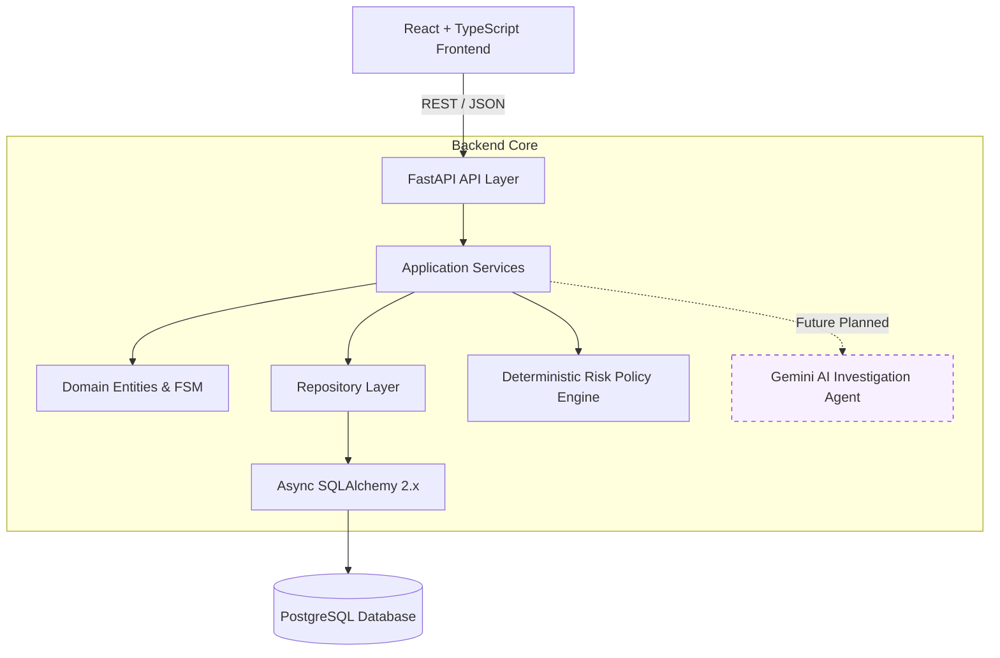

# System Architecture: AegisPay AI

## 1. Architectural Style & Philosophy

AegisPay AI is designed as a **Modular Monolith**. Rather than fragmenting the early platform into premature microservices, message brokers, and distributed coordination layers, the system maintains strict module boundaries within a single deployable backend and an accompanying client frontend.

### Core Design Principles:
1. **Separation of Determinism and Heuristics**: Deterministic policy rules (hard velocity limits, sanctions lists, legal transaction caps) always supersede generative AI judgments. The AI provides investigation findings and duress sentiment scores; it does not unilaterally approve high-risk transfers without deterministic validation.
2. **Strict Layered Boundaries**:
   - `api/`: Thin HTTP adapters; handles request validation, status codes, and routing. No business logic.
   - `services/`: Coordinates workflows, orchestrates state transitions, interacts with repositories.
   - `domain/`: Pure business logic, entity definitions, and state machine validation rules.
   - `repositories/`: Persistence abstraction for PostgreSQL via SQLAlchemy.
3. **Auditability by Design**: Every state change in the transaction lifecycle produces an immutable event record.

---

## 2. Technology Stack

| Layer | Technology | Justification & Role |
| :--- | :--- | :--- |
| **Backend Framework** | Python 3.14 + FastAPI | High-performance asynchronous API framework with native OpenAPI schema generation and standard typing. |
| **Data Validation** | Pydantic v2 + pydantic-settings | Strict runtime validation, fast C-based parsing, typed environment settings. |
| **Persistence / ORM** | SQLAlchemy 2.x (asyncio) + psycopg3 | Mature async ORM with explicit transaction boundaries, connection pooling, and connection recycling. |
| **Migrations** | Alembic | Version-controlled, reproducible relational database schema migrations. |
| **Package & Env Manager** | `uv` | Ultra-fast Rust-based package installer and virtual environment manager. |
| **Code Quality** | Ruff & mypy | Instant linting/formatting (Ruff) and rigorous static type safety (mypy). |
| **Testing** | pytest + pytest-asyncio + HTTPX | Asynchronous unit and integration testing suite. |
| **Frontend Framework** | React 18 / 19 + TypeScript | Component-based interactive interface with end-to-end type safety. |
| **Build Tool** | Vite | Instant HMR development server and optimized production bundler. |
| **Containerization** | Docker & Docker Compose | Isolated, reproducible container runtime for PostgreSQL. |
| **CI / CD** | GitHub Actions | Automated linting, typechecking, and test execution on push/PR. |

---

## 3. Component Responsibilities

### Backend Layout
- `backend/app/main.py`: Application entry point; initializes FastAPI lifespan, mounts CORS, registers error handlers, attaches routers.
- `backend/app/core/config.py`: Centralized `Settings` model powered by `pydantic-settings`. Loads from environment variables and `.env`.
- `backend/app/core/errors.py`: Custom application exceptions (`AppException`, `NotFoundError`, `ConflictError`, `DatabaseConnectionError`) and structured JSON error response format.
- `backend/app/core/logging.py`: Structured JSON logger with sensitive credential/PII redaction.
- `backend/app/db/base.py`: SQLAlchemy `DeclarativeBase` metadata registry.
- `backend/app/db/session.py`: Asynchronous engine creation, connection pooling (`pool_size`, `max_overflow`), session factory (`async_sessionmaker`), and health check query routine.
- `backend/app/api/health.py`: Liveness (`/health/live`) and database readiness (`/health/ready`) endpoints.
- `backend/app/api/router.py`: Root versioned API router (`/api/v1`).
- `backend/app/domain/`: Pure transaction domain entity, 10-state workflow finite state machine, and state transition policy validation rules.
- `backend/app/repositories/`: Data access layer for transaction persistence, idempotency lookups, and audit history.
- `backend/app/services/`: Application service orchestrating atomic transaction creation, transition validation, and audit recording.

### Automated Decision Workflow (P2-A4)
See [ADR-003](../decisions/ADR-003-automated-decision-workflow.md). A pure-domain
deterministic **policy engine** (`app/domain/decision_policy.py`, versioned
`p2a4.v1`) maps structured risk + investigation inputs to a typed action
(`ALLOW`, `REQUIRE_VERIFICATION`, `HOLD_FOR_INVESTIGATION`, `BLOCK`). The
`DecisionWorkflowService` orchestrates: deterministic risk assessment → optional
investigation (skipped for low risk; failures fall back to deterministic rules
without downgrading) → policy decision → the corresponding permitted transition
via the existing state machine (`ALLOW→SETTLED_SIMULATED`,
`REQUIRE_VERIFICATION→VERIFICATION_REQUIRED`, `HOLD→HELD_FOR_VERIFICATION`,
`BLOCK→CANCELLED_SIMULATED`) → a persisted `transaction_decisions` record
(migration `0007`). The LLM never selects the action (findings only escalate the
conservative baseline; confidence is never treated as probability). The workflow
is idempotent (one decision per transaction) and protected by the existing
operator auth boundary via `POST/GET /api/v1/transactions/{id}/evaluate|decision`.

### Transaction Lifecycle & State Machine (10 States)
The transaction workflow finite state machine manages simulated payment progression across 10 workflow states:
1. `INITIATED`: Transaction received and staged.
2. `ASSESSING`: Fast initial telemetry ingestion.
3. `RISK_ASSESSED`: Deterministic checks and scores computed.
4. `DECISION_READY`: Risk and compliance evaluation synthesized.
5. `VERIFICATION_REQUIRED`: Escalation to customer inquiry initiated.
6. `HELD_FOR_VERIFICATION`: Simulated payment pre-settlement hold active.
7. `INVESTIGATING`: Active conversational / contextual investigation in progress.
8. `HUMAN_REVIEW`: Escalated to fraud operations analyst.
9. `SETTLED_SIMULATED`: Terminal state; simulated funds released.
10. `CANCELLED_SIMULATED`: Terminal state; simulated transfer aborted without fund movement.

Allowed Transition Matrix:
- `INITIATED` -> `ASSESSING`, `CANCELLED_SIMULATED`
- `ASSESSING` -> `RISK_ASSESSED`, `HUMAN_REVIEW`
- `RISK_ASSESSED` -> `DECISION_READY`, `HUMAN_REVIEW`
- `DECISION_READY` -> `VERIFICATION_REQUIRED`, `HELD_FOR_VERIFICATION`, `SETTLED_SIMULATED`, `CANCELLED_SIMULATED`, `HUMAN_REVIEW`
- `VERIFICATION_REQUIRED` -> `INVESTIGATING`, `CANCELLED_SIMULATED`
- `HELD_FOR_VERIFICATION` -> `INVESTIGATING`, `CANCELLED_SIMULATED`
- `INVESTIGATING` -> `DECISION_READY`, `HUMAN_REVIEW`, `CANCELLED_SIMULATED`
- `HUMAN_REVIEW` -> `DECISION_READY`, `HELD_FOR_VERIFICATION`, `CANCELLED_SIMULATED`
- `SETTLED_SIMULATED` & `CANCELLED_SIMULATED`: Terminal states; no further transitions.

### Frontend Layout & Preserved Prototype UI
- `frontend/src/App.tsx`: Preserved interactive console layout matching the provided screenshot (`Aster Bank` / Live payment console). Includes the 6-metric summary strip, bank-wide payment queue with sorting/filtering, inspection drawer, scenario controls, and the interactive Android preview mobile phone simulator.
- `frontend/src/components/HealthStatus.tsx` & `frontend/src/components/BackendHealthBadge.tsx`: Integrated component querying backend `/health/ready` and displaying live API and database connection status directly in the console header.
- `frontend/src/components/error-boundary.tsx`: Runtime error recovery wrapper.
- `frontend/src/index.css`: Bespoke stylesheet preserving all visual styles, spacing, typography, mobile mockup frames, and speech bubble layouts.
- `frontend/src/config.ts`: Client configuration reading `VITE_API_BASE_URL`.
- Excluded Replit-specific plugins, ephemeral connector SDKs, and Express backend stubs from the prototype archive.

---

## 4. Database & Connection Management

- **Driver**: `psycopg` v3 async driver (`postgresql+psycopg://`).
- **Connection Pooling**:
  - `POSTGRES_POOL_SIZE`: Default 5 connections.
  - `POSTGRES_MAX_OVERFLOW`: Default 10 overflow connections.
  - `pool_pre_ping=True`: Proactively validates connection health before handing it to a request.
- **Session Scope**: FastAPI dependency `get_db_session()` provides an async session scoped to the lifecycle of an individual HTTP request, with automatic rollback upon uncaught exceptions.
- **Migrations**: Alembic manages schema versioning under `backend/app/db/migrations`.

---

## 5. Security & Isolation Architecture

0. **Operator Authentication & Authorization** (see [ADR-002](../decisions/ADR-002-operator-authentication.md)):
   - Every operations-console route (`/api/v1/transactions`, `/api/v1/risk`,
     `/api/v1/investigations`, `/api/v1/conversations`) requires an authenticated
     operator via the `get_current_operator` dependency. `/api/v1/auth/login` and
     `/health/*` are public.
   - Identity is server-validated: login checks a bcrypt password hash in the
     `operators` table and issues a short-lived HS256 **Bearer JWT** (`AUTH_JWT_SECRET`);
     identity is never inferred from a caller-supplied id or header.
   - Authorization model is **operator-shared** (any active operator may access any
     case), matching the bank-wide operations-console persona. Transaction-scoped
     conversation routes additionally enforce `conversation.transaction_id == transaction_id`.
   - Auth fails closed: no default signing secret; missing config → 503; bad
     credentials/tokens → generic `401 UNAUTHENTICATED`.

1. **Zero Secret Leakage**:
   - Error handlers redact raw exception tracebacks and database connection details from client responses.
   - Vite environment variables are explicitly scoped (`VITE_*`) and documented as public browser-facing strings.
2. **CORS Configuration**: Restricts access to configured origins (`CORS_ORIGINS`), with sensible defaults for local development.
3. **Database Network Exposure**: Docker Compose binds PostgreSQL port `5432` only to `127.0.0.1`.

---

## 6. Architecture Decision Records (ADRs)

- [ADR-001: Initial Architecture Baseline](../decisions/ADR-001-initial-architecture.md)
- [ADR-002: Operator Authentication & Authorization Boundary](../decisions/ADR-002-operator-authentication.md)
- [ADR-003: Automated Decision Workflow & Deterministic Policy Engine](../decisions/ADR-003-automated-decision-workflow.md)

---

## 7. Future Integrations (Marked Planned)

The following components are deferred to subsequent phases:
- `[PLANNED]` Gemini Multimodal Investigation Engine (Phase 3).
- `[IMPLEMENTED — P2-A11]` Real-time WebSocket voice session: `WS /api/v1/calls/{id}/live`
  streams 16 kHz PCM16 mic audio to the backend, which relays to the Gemini Live API and
  streams 24 kHz PCM16 audio + transcription back. The backend persists final transcript
  segments (`call_transcript_segments`) and runs a parallel, advisory evidence analyzer
  (`call_live_analyses`, versioned `live-analysis-v1`) without blocking audio. The Gemini
  key stays server-side; the WebSocket is authenticated and transaction-scoped. Deterministic
  policy remains the sole authority for transaction-state changes. See
  [ADR-008](../decisions/ADR-008-dynamic-simulated-voice-and-chat.md). (Real Gemini Live
  verified with mocks; real-provider smoke test gated behind `GEMINI_LIVE_SMOKE`.)
- `[IMPLEMENTED — P2-A12]` Recipient Intelligence Registry & Selective Bank Calls:
  - Persistent fictional recipient registry (`fictional_recipients`, migration 0015) seeds 20 deterministic identities (8 trusted, 5 unknown, 7 high-risk mules/collectors/impersonators).
  - `RiskService` resolves `recipient_identifier` against server registry; authoritative DB values override client-supplied mock flags to prevent client-side parameter spoofing.
  - Automated decision workflow selectively triggers bank-initiated outbound calls only when policy authorizes customer intervention (`REQUIRE_VERIFICATION`).
  - Customer-scoped tokens are explicitly forbidden (`403 FORBIDDEN`) from initiating calls directly.
  - Call creation in simulated voice mode is decoupled from text model availability when Live mode is enabled, and Gemini settings canonicalization resolves multi-directory `.env` files with sanitized credentials.
- `[PLANNED]` Simulated WhatsApp / SMS Messaging Webhook (Phase 2).
- `[PLANNED]` Document Inspection & Invoice Parsing Service (Phase 3).
- `[PLANNED]` Operations Console UI (Phase 4).
